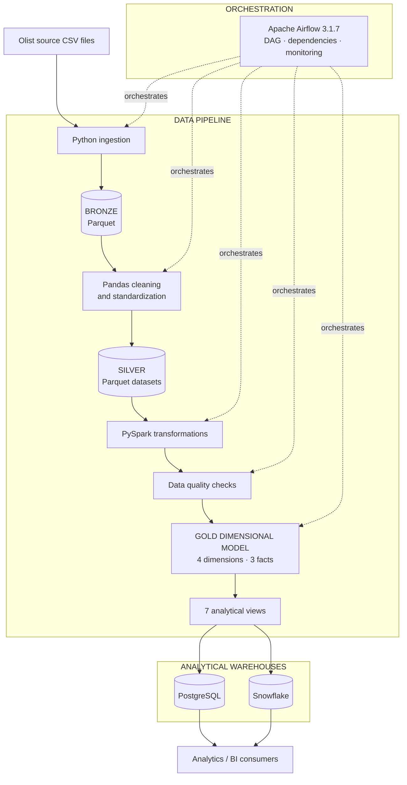
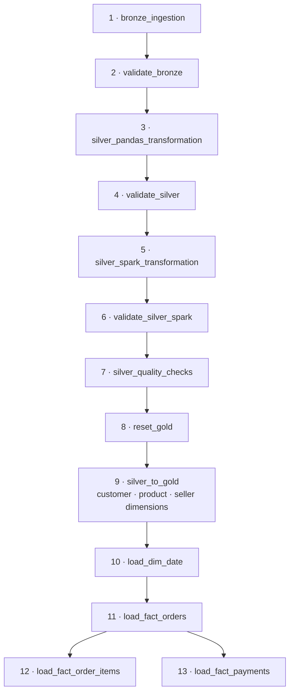

::: {align="center"}
# CommerceFlow

### End-to-End E-commerce Data Engineering Pipeline

**A batch data platform that transforms Brazilian e-commerce source data
into analytics-ready data products using Python, Pandas, Apache Spark,
Apache Airflow, PostgreSQL and Snowflake.**

[](https://www.python.org/)
[](https://airflow.apache.org/)
[](https://spark.apache.org/)
[](https://www.postgresql.org/)
[](https://www.snowflake.com/)
[](https://www.docker.com/)

[Architecture](#architecture) · [Workflow](#pipeline-workflow) · [Data
model](#gold-data-model) · [Validation](#validation-results) ·
[Setup](#getting-started)
:::

------------------------------------------------------------------------

## Overview

**CommerceFlow** is a portfolio data engineering project built around
the Brazilian Olist e-commerce public dataset. It demonstrates an
end-to-end batch pipeline: source CSV ingestion, layered Parquet
storage, data cleaning, Spark processing, dimensional modelling, data
quality validation and warehouse loading.

The pipeline follows a **Bronze → Silver → Gold** architecture. Apache
Airflow coordinates the workflow and its dependencies. PostgreSQL
provides a local analytical warehouse, while Snowflake is used as a
cloud warehouse target.

### What this project demonstrates

-   Python-based ingestion from CSV to Parquet.
-   Layered data organization using Bronze, Silver and Gold.
-   Data cleaning with Pandas and PySpark.
-   Data quality checks for expected datasets, nulls, uniqueness and
    relationships.
-   Dimensional modelling with fact and dimension tables.
-   Airflow DAG orchestration, task dependencies and parallel execution.
-   Dockerized Airflow runtime with Java, Spark and PostgreSQL JDBC
    support.
-   PostgreSQL and Snowflake warehouse integration and reconciliation.

> **Verified project milestone:** The full 13-task Bronze → Silver →
> Gold Airflow DAG completed successfully. The rebuilt PostgreSQL Gold
> layer contained seven tables, 442,238 rows in total, and six validated
> foreign-key constraints. Snowflake Gold and seven-view
> PostgreSQL/Snowflake reconciliation were validated earlier in the
> project.

## Project at a glance

  Component       Implementation
  --------------- -------------------------------------------------
  Dataset         Brazilian Olist e-commerce
  Ingestion       Python, CSV → Parquet
  Bronze          Ingested Parquet datasets
  Silver          Pandas and PySpark transformations
  Gold            4 dimensions, 3 fact tables, 7 analytical views
  Orchestration   Apache Airflow 3.1.7
  Processing      Apache Spark 4.3.0
  Warehouses      PostgreSQL 16 and Snowflake
  Runtime         Docker Compose, Java 17
  Languages       Python and SQL

------------------------------------------------------------------------

## Architecture

The architecture separates source ingestion, transformation,
orchestration and analytical storage. Airflow coordinates the work;
Python, Pandas and Spark perform the data processing.



### Technology responsibilities

  -----------------------------------------------------------------------
  Technology                          Role
  ----------------------------------- -----------------------------------
  Python                              Ingestion, transformation scripts,
                                      validation and warehouse loading

  Pandas                              Initial Silver-layer cleaning and
                                      standardization

  Apache Spark                        Spark-based Silver processing and
                                      Gold loading

  Apache Airflow                      Workflow orchestration,
                                      dependencies and monitoring

  PostgreSQL                          Local relational warehouse and Gold
                                      validation

  Snowflake                           Cloud data warehouse target

  Docker Compose                      Repeatable Airflow and database
                                      runtime

  Java 17                             JVM runtime for Spark
  -----------------------------------------------------------------------

------------------------------------------------------------------------

## Pipeline workflow

The Airflow DAG is named `commerceflow_pipeline` and contains **13
tasks**. Tasks execute in dependency order, with the two final fact
loaders running in parallel.



  --------------------------------------------------------------------------------
  Stage                   Airflow task                     Responsibility
  ----------------------- -------------------------------- -----------------------
  Bronze                  `bronze_ingestion`               Converts source CSV
                                                           files to Bronze Parquet

  Bronze                  `validate_bronze`                Checks Bronze outputs
                                                           and metadata

  Silver                  `silver_pandas_transformation`   Cleans and standardizes
                                                           data with Pandas

  Silver                  `validate_silver`                Validates Pandas Silver
                                                           outputs

  Silver                  `silver_spark_transformation`    Processes Parquet
                                                           datasets with PySpark

  Silver                  `validate_silver_spark`          Checks Spark Silver
                                                           datasets

  Silver                  `silver_quality_checks`          Runs Silver quality
                                                           checks

  Gold                    `reset_gold`                     Clears the configured
                                                           Gold target before a
                                                           full rebuild

  Gold                    `silver_to_gold`                 Loads customer, product
                                                           and seller dimensions

  Gold                    `load_dim_date`                  Loads the date
                                                           dimension

  Gold                    `load_fact_orders`               Loads the orders fact

  Gold                    `load_fact_order_items`          Loads the order-items
                                                           fact

  Gold                    `load_fact_payments`             Loads the payments fact
  --------------------------------------------------------------------------------

**Operational note:** Gold loaders currently use append writes. Gold
tasks have retries disabled to avoid automatically duplicating rows
after a partial write. If a Gold task fails, inspect its logs and
restart the Gold phase from `reset_gold` rather than retrying an
individual loader against partially loaded tables.

------------------------------------------------------------------------

## Data layers

### Bronze --- ingestion

Source CSV files are ingested into Parquet format, creating a consistent
landing layer for downstream processing.

### Silver --- cleaning and standardization

Silver processing is performed in two stages:

1.  **Pandas Silver:** performs dataset cleaning and standardization.
2.  **PySpark Silver:** reads Bronze Parquet datasets and produces
    Spark-processed Silver Parquet outputs.

One example of cleaning is geolocation deduplication: the source
contained 1,000,163 rows, reduced to 738,332 after exact duplicate rows
were removed.

### Gold --- analytics

Gold organizes the data into a dimensional model designed for analytical
queries. It contains four dimensions, three fact tables and seven
analytical views.

------------------------------------------------------------------------

## Gold data model

``` mermaid
erDiagram
    DIM_CUSTOMERS ||--o{ FACT_ORDERS : customer_key
    DIM_CUSTOMERS ||--o{ FACT_ORDER_ITEMS : customer_key
    DIM_CUSTOMERS ||--o{ FACT_PAYMENTS : customer_key
    DIM_DATE ||--o{ FACT_ORDERS : purchase_date_key
    DIM_PRODUCTS ||--o{ FACT_ORDER_ITEMS : product_key
    DIM_SELLERS ||--o{ FACT_ORDER_ITEMS : seller_key

    DIM_CUSTOMERS {
        bigint customer_key PK
        string customer_id
        string customer_unique_id
    }
    DIM_PRODUCTS {
        bigint product_key PK
        string product_id
    }
    DIM_SELLERS {
        bigint seller_key PK
        string seller_id
    }
    DIM_DATE {
        int date_key PK
        date full_date
    }
    FACT_ORDERS {
        string order_id
        bigint customer_key FK
        int purchase_date_key FK
    }
    FACT_ORDER_ITEMS {
        string order_id
        int order_item_id
        bigint customer_key FK
        bigint product_key FK
        bigint seller_key FK
    }
    FACT_PAYMENTS {
        string order_id
        int payment_sequential
        bigint customer_key FK
    }
```



### Gold tables and verified row counts

Counts below were observed after the successful Airflow rebuild in
PostgreSQL database `commerceflow_spark_test`.

  Table                Type                 Rows
  -------------------- ----------- -------------
  `dim_customers`      Dimension          99,441
  `dim_products`       Dimension          32,951
  `dim_sellers`        Dimension           3,095
  `dim_date`           Dimension             774
  `fact_orders`        Fact               99,441
  `fact_order_items`   Fact              112,650
  `fact_payments`      Fact              103,886
  **Total**                          **442,238**

### Analytical views

Seven views support downstream analysis:

-   `monthly_sales`
-   `customer_sales`
-   `product_performance`
-   `seller_performance`
-   `payment_analysis`
-   `delivery_performance`
-   `review_analysis`

These cover sales trends, customer purchasing, product and seller
performance, payment methods, delivery performance and review analysis.

------------------------------------------------------------------------

## Data quality and validation

Validation is included throughout the pipeline, not only after warehouse
loading.

Checks include:

-   Expected datasets and Parquet readability.
-   Expected row counts.
-   Null checks on important fields.
-   Uniqueness checks on business and composite keys.
-   Exact duplicate handling for geolocation records.
-   Referential integrity between Gold fact and dimension tables.

### Verified results

  Validation                                                 Result
  --------------------------------------- -------------------------
  Spark Silver quality checks                   19 passed, 0 failed
  Airflow tasks in full run                           13 successful
  Gold tables populated                                      7 of 7
  Gold records after rebuild                                442,238
  PostgreSQL Gold foreign keys                          6 validated
  PostgreSQL/Snowflake analytical views     7 previously reconciled

The six validated PostgreSQL relationships are:

1.  `fact_order_items.customer_key` → `dim_customers.customer_key`
2.  `fact_order_items.product_key` → `dim_products.product_key`
3.  `fact_order_items.seller_key` → `dim_sellers.seller_key`
4.  `fact_orders.customer_key` → `dim_customers.customer_key`
5.  `fact_orders.purchase_date_key` → `dim_date.date_key`
6.  `fact_payments.customer_key` → `dim_customers.customer_key`

------------------------------------------------------------------------

## Snowflake integration

The project also loads Silver and Gold data into Snowflake.

The Snowflake environment includes:

-   `COMMERCEFLOW_DB` database.
-   `BRONZE`, `SILVER` and `GOLD` schemas.
-   An internal stage and Parquet file format.
-   Silver datasets loaded from Spark Parquet outputs.
-   Four Gold dimensions, three Gold facts and seven analytical views.

The seven Snowflake Gold analytical views were previously reconciled
against their PostgreSQL counterparts, with matching results.

The Python Snowflake connection uses key-pair authentication. Private
keys and credentials are intentionally excluded from this repository.

------------------------------------------------------------------------

## Repository structure

``` text
CommerceFlow/
├── dags/
│   └── commerceflow_pipeline.py
├── data/                         # Local generated data; not committed
│   ├── raw/
│   ├── bronze/
│   ├── silver/
│   ├── silver_spark/
│   ├── rejected/
│   └── metadata/
├── docker/
│   ├── Dockerfile
│   └── jars/
│       └── postgresql-42.7.10.jar
├── docs/                         # Documentation and screenshots
├── notebooks/
│   └── 01_dataset_exploration.ipynb
├── sql/
│   ├── gold/
│   └── snowflake/
│       └── gold/
├── src/
│   ├── ingestion/
│   ├── transformations/
│   ├── quality/
│   └── utils/
├── tests/
├── .gitignore
├── docker-compose.yml
├── docker-compose-airflow.yml
└── README.md
```

Local datasets, logs, virtual environments, environment files and the
large PySpark wheel are excluded from Git.

------------------------------------------------------------------------

## Getting started

### Prerequisites

-   Git
-   Docker Desktop with Docker Compose
-   Python 3.11 or compatible Python for local scripts
-   Java 17 for local Spark execution
-   A Snowflake account for reproducing the Snowflake integration

The custom Airflow image installs Java 17, PySpark 4.3.0 and the
PostgreSQL JDBC driver.

### 1. Clone the repository

``` bash
git clone https://github.com/ViNkiNG1008/CommerceFlow.git
cd CommerceFlow
```

### 2. Configure environment variables

Create local `.env` and `.env.airflow` files. Never commit either file.

The project `.env` should define PostgreSQL settings used by the Python
scripts:

``` dotenv
POSTGRES_DB=commerceflow
POSTGRES_USER=your_postgres_user
POSTGRES_PASSWORD=your_secure_password
POSTGRES_HOST=localhost
POSTGRES_PORT=5432
```

The `.env.airflow` file should define the Airflow metadata database and
security settings expected by `docker-compose-airflow.yml`:

``` dotenv
AIRFLOW_UID=50000
AIRFLOW_DB_USER=your_airflow_db_user
AIRFLOW_DB_PASSWORD=your_airflow_db_password
AIRFLOW_DB_NAME=airflow
AIRFLOW_FERNET_KEY=your_fernet_key
AIRFLOW__API_AUTH__JWT_SECRET=your_jwt_secret
```

Use newly generated secrets for your environment. Never publish
passwords, private keys, Fernet keys or JWT secrets.

The Compose configuration also passes project PostgreSQL credentials
into Airflow for Gold loading. Review `docker-compose-airflow.yml` and
ensure `POSTGRES_USER` and `POSTGRES_PASSWORD` are available through the
project `.env`.

Snowflake scripts additionally require account, user, warehouse,
database, schema and key-pair authentication settings. Keep the private
key outside the repository and set `SNOWFLAKE_PRIVATE_KEY_PATH` to its
local path.

### 3. Download the source dataset

Download the [Olist Brazilian E-Commerce
dataset](https://www.kaggle.com/datasets/olistbr/brazilian-ecommerce)
and place its CSV files in:

``` text
data/raw/
```

The data directory is intentionally not committed; source data and
generated Parquet files remain local pipeline inputs and artifacts.

### 4. Start PostgreSQL

From PowerShell:

``` powershell
docker compose up -d
docker ps
```

### 5. Start Airflow

Load both environment files when invoking Compose:

``` powershell
docker compose --env-file .env --env-file .env.airflow -f docker-compose-airflow.yml up -d
```

Open the Airflow UI at:

http://localhost:8080

Log in with the credentials configured for your Airflow environment.

### 6. Run the pipeline

In the Airflow UI:

1.  Find `commerceflow_pipeline`.
2.  Open the DAG.
3.  Trigger a manual run.
4.  Monitor task progress in Grid or Graph view.
5.  Inspect task logs if a task fails.

> **Important:** The current `reset_gold` task is destructive for the
> configured Gold target database. Verify `COMMERCEFLOW_POSTGRES_DB`
> before triggering the DAG. Use a dedicated development/test database
> when reproducing the full reset-and-rebuild workflow.

------------------------------------------------------------------------

## Screenshots and demo

Add actual screenshots to `docs/images/` as they are captured. Suggested
images:

  -------------------------------------------------------------------------
  Suggested image                       What it demonstrates
  ------------------------------------- -----------------------------------
  `docs/images/airflow-dag.png`         Full 13-task DAG and successful
                                        execution

  `docs/images/airflow-grid.png`        Task states and execution history

  `docs/images/postgres-gold.png`       Gold table counts and relational
                                        structure

  `docs/images/snowflake-gold.png`      Snowflake schemas and analytical
                                        views

  `docs/images/powerbi-dashboard.png`   Power BI dashboard, if included in
                                        the final project
  -------------------------------------------------------------------------

Embed a screenshot in this README using:

``` markdown

```

### Project walkthrough video

Add the public or unlisted video URL after recording the walkthrough:

`[Watch the CommerceFlow walkthrough](YOUR_VIDEO_URL)`

Suggested walkthrough: architecture, Bronze/Silver/Gold processing,
Airflow orchestration, dimensional model and warehouse validation.

------------------------------------------------------------------------

## Engineering considerations

-   **Parquet between layers:** provides a consistent columnar hand-off
    format between processing stages.
-   **Pandas and Spark Silver stages:** demonstrate both dataframe-based
    cleaning and Spark processing.
-   **Dimensional Gold model:** separates descriptive dimensions from
    measurable business events.
-   **Airflow dependencies:** make execution order and parallelism
    explicit.
-   **Quality checks:** detect data issues before Gold is considered
    ready.
-   **Environment-based configuration:** keeps credentials out of source
    code and allows local/container connection settings to differ.
-   **Dockerized Airflow:** provides a repeatable orchestration runtime
    with Java, Spark and the JDBC driver installed.

## Future improvements

-   Add automated unit and integration tests to CI.
-   Make Gold loads idempotent without requiring a full reset.
-   Add incremental ingestion and change-data handling.
-   Introduce retry policies based on task idempotency.
-   Add data lineage and freshness monitoring.
-   Add automated Snowflake orchestration to the Airflow DAG.
-   Add cloud deployment and operational monitoring.
-   Add Power BI screenshots and the recorded project walkthrough.

------------------------------------------------------------------------

## Author

**CommerceFlow** --- an end-to-end data engineering portfolio project
demonstrating batch processing, dimensional modelling, data quality,
orchestration and warehouse integration.

**Repository:** https://github.com/ViNkiNG1008/CommerceFlow

::: {align="center"}
*Python · Pandas · Apache Spark · Apache Airflow · PostgreSQL ·
Snowflake · Docker*
:::
